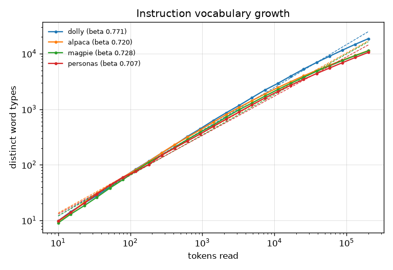

# divscore

Measure the lexical and structural diversity of a text dataset, with every metric taken at a fixed budget of tokens
or texts so that datasets of different sizes can be compared.

## Why this is hard

Almost every diversity number moves with the amount of text it is computed on. Distinct-n falls as a corpus grows,
because common n-grams keep repeating while new ones arrive more slowly; a compressor finds more repeats in more
text, so the compression ratio rises; the Vendi score of k texts can never exceed k, and a near-duplicate is easier
to find among more texts. A dataset of 50,000 records can look less diverse than one of 15,000 records for no
reason other than size, and the order of two datasets can flip once size is held fixed (the dolly and alpaca
comparison below is one such flip). Shaib et al. (2024) make the same point about text length and recommend
reporting length beside every score.

## Install

```
pip install git+https://github.com/vipul21435/divscore
```

Python 3.10 or newer. The only runtime dependency is numpy. For `divscore curve --plot`, add matplotlib:

```
pip install "divscore[plot] @ git+https://github.com/vipul21435/divscore"
```

## Quickstart

`examples/data/` holds two small files written for this repo: 30 varied questions and 30 prompts built from three
templates. The budgets are about half of the smaller file (294 tokens, 30 texts); see the note on budget size below.

```
divscore compare examples/data/varied.jsonl examples/data/templated.jsonl --budget 140 --texts 15 --resamples 200
```

```
## varied.jsonl (A) vs templated.jsonl (B)

A: 30 texts, 405 tokens. B: 30 texts, 294 tokens.
200 subsamples per side and budget, seed 0.

Budget: 140 tokens

| metric | better | A | B | A - B | 95 % interval | whole data A - B | more diverse |
|---|---|---:|---:|---:|---|---:|---|
| distinct-1 | higher | 0.7018 | 0.2541 | 0.4476 | [0.3786, 0.5002] | 0.4306 | A |
| distinct-2 | higher | 0.9810 | 0.3894 | 0.5916 | [0.5292, 0.6353] | 0.7035 | A |
| distinct-3 | higher | 0.9967 | 0.4848 | 0.5119 | [0.4600, 0.5556] | 0.6566 | A |
| entropy-1 | higher | 6.2773 | 4.2568 | 2.0205 | [1.8111, 2.2416] | 2.7657 | A |
| entropy-2 | higher | 6.9739 | 4.9486 | 2.0253 | [1.9096, 2.1392] | 3.2398 | A |
| cr-gzip | lower | 1.5709 | 3.2473 | -1.6765 | [-1.9057, -1.4583] | -3.1776 | A |
| cr-bz2 | lower | 1.4737 | 2.6893 | -1.2156 | [-1.3743, -1.0594] | -2.2299 | A |
| heaps-beta | higher | 0.8394 | 0.5254 | 0.3140 | [0.0033, 0.5697] | 0.3639 | A |

Budget: 15 texts

| metric | better | A | B | A - B | 95 % interval | whole data A - B | more diverse |
|---|---|---:|---:|---:|---|---:|---|
| self-bleu | lower | 0.0325 | 0.7225 | -0.6900 | [-0.7732, -0.6073] | n/a | A |
| rouge-l | lower | 0.1166 | 0.6167 | -0.5001 | [-0.5317, -0.4661] | n/a | A |
| vendi | higher | 14.0421 | 5.0903 | 8.9519 | [8.3795, 9.4519] | n/a | A |
| near-dup | lower | 0.0000 | 0.0000 | 0.0000 | [0.0000, 0.0000] | n/a | unclear |
| opening-top10 | lower | 0.6667 | 1.0000 | -0.3333 | [-0.3333, -0.3333] | -0.6667 | A |
| opening-hhi | lower | 0.0667 | 1.0000 | -0.9333 | [-0.9333, -0.9333] | -0.9667 | A |
| template-top10 | lower | 0.0000 | 0.9963 | -0.9963 | [-1.0000, -0.9333] | n/a | A |
```

`divscore measure FILE` prints the same tables for one dataset, `divscore openings FILE` lists the most common
openings and templates, and `divscore curve FILE...` prints (and with `--plot out.png` draws) type-token curves with
their Heaps' law fits. Every command takes `--format json` and `-o FILE`. `--field` picks the text field (a dotted
path, or several joined with `+` such as `instruction+input`), `--role user` takes the turns of one speaker from
chat records (`messages` with `role`/`content`, or `conversations` with `from`/`value`), and `--input-format`
overrides the guess from the file extension (jsonl, json, csv, tsv, txt with one text per line). `python
examples/measure_examples.py` does the same through the Python API.

## How it works

**Two budgets.** Texts are tokenised into words and punctuation (lowercased unless `--keep-case`; `--truncate N`
first cuts every text to N tokens). Each metric is computed on many random subsamples of a fixed size and reported
as the mean over subsamples with the standard deviation and the equal-tailed percentile interval (`--level`,
default 95 %). The interval says how much the metric moves between random samples of that size; it is not a
confidence interval for the whole-dataset value, which is printed beside it where it is cheap to compute.

| metric | held at | whole-dataset value printed |
|---|---|---|
| distinct-1, -2, -3; entropy-1, -2; cr-gzip, cr-bz2; heaps-beta | `--budget` tokens (default 10,000) | yes |
| self-bleu, rouge-l, vendi, near-dup, template-top10 | `--texts` texts (default 500) | no (cost grows with the square of the number of texts) |
| opening-top10, opening-hhi | `--texts` texts | yes |

A token subsample draws texts in random order without replacement until exactly `--budget` tokens are taken; the
last text is cut at the token where the budget is reached, and its raw text at the same character. A text
subsample draws exactly `--texts` whole texts without replacement. The metrics that compare texts with each other
(similarity, duplicates, openings) depend on how many texts are compared, so the number of texts is what is held
fixed for them; their values still depend on text length, which `--truncate` controls.

`compare A B` draws independent subsamples from A and B at the same budgets (100 each by default, with seeds
`--seed` and `--seed + 1`), reports the difference of the means, and the percentile interval of the draw-by-draw
differences A_r - B_r. The "more diverse" column names the side the interval favours, or "unclear" when the
interval contains zero; it is not a significance test, and no permutation test is implemented. **Budget size
matters for that column:** as the budget approaches the size of a dataset, every subsample is nearly the whole
dataset and the interval shrinks towards zero, so small differences get a side. `divscore` prints a warning when a
budget is above half of a dataset's tokens or texts.

**Metrics.** N-grams never cross a text boundary.

- **distinct-n**: distinct n-grams over total n-grams. Li et al. (2016), [A Diversity-Promoting Objective Function
  for Neural Conversation Models](https://arxiv.org/abs/1510.03055), state distinct-1 and distinct-2 as distinct
  unigrams and bigrams "divided by total number of generated words"; that form is `distinct_n(..., per="token")`
  in the API. The two agree for n = 1.
- **entropy-n**: Shannon entropy in bits of the empirical unigram or bigram distribution.
- **cr-gzip, cr-bz2**: uncompressed bytes over compressed bytes of the texts joined by newlines (lzma in the API).
  Shaib et al. (2024), [Standardizing the Measurement of Text Diversity](https://arxiv.org/abs/2403.00553), define
  the compression ratio as original size over gzip size and report that high values mean more redundancy.
- **heaps-beta**: the exponent of Heaps' law V = K N^beta, fitted by least squares in log space to the number of
  distinct tokens V after N tokens, at 12 points spaced on a log scale from 50 tokens to the end of the subsample.
  The whole-dataset value is the mean of the fit over five seeded shuffles of the texts, since a single fit in file
  order depends on how the file is sorted.
- **self-bleu**: each text scored by BLEU-4 against all other texts of the subsample as references, averaged, as in
  Texygen (Zhu et al., 2018, [arXiv:1802.01886](https://arxiv.org/abs/1802.01886); the project's
  [evaluation notes](https://github.com/geek-ai/Texygen/blob/master/docs/evaluation.md) describe it as "Regarding
  one sentence as hypothesis and the others as reference"). Clipping uses the largest
  count in any one reference, the brevity penalty the closest reference length, and NLTK's "method 1" smoothing;
  the tests check it against `nltk.translate.bleu_score.sentence_bleu`. Keeping the largest and second-largest
  count of every n-gram over the subsample gives the leave-one-out clipping counts in one pass.
- **rouge-l**: the homogenisation score of Shaib et al. (2024), which averages ROUGE-L over all pairs of texts;
  here with ROUGE-L F1, over 500 pairs per subsample drawn at random with replacement, each pair joining two
  different texts. The LCS is computed with a bit-vector recurrence on Python integers; the
  tests check it against a plain dynamic programme and the F1 against the `rouge-score` package.
- **vendi**: the Vendi score of Friedman and Dieng (2022), [The Vendi Score: A Diversity Evaluation Metric for
  Machine Learning](https://arxiv.org/abs/2210.02410), "the exponential of the Shannon entropy of the eigenvalues of
  a similarity matrix", here of K / k for k texts with similarity matrix K. The similarity is the cosine between
  count vectors of each text's unigrams and bigrams, hashed with CRC-32 into 2^20 buckets; eigenvalues come from
  `numpy.linalg.eigvalsh`. It is 1 for identical texts and k for k texts with no shared n-gram, so at a text
  budget of 500 it reads as an effective number of distinct texts out of 500.
- **near-dup**: share of texts that have at least one other text in the subsample with estimated Jaccard similarity
  of 5-token shingles of at least 0.8. A small MinHash implementation (128 hash functions (a x + b) mod (2^31 - 1),
  32 bands of 4 rows for candidates) does the estimate.
- **opening-top10, opening-hhi**: the first three word tokens of each text are its opening; top10 is the share of
  texts whose opening is one of the ten most common, hhi is the Herfindahl index (sum of squared opening shares,
  1/k when all k openings differ, 1 when all are the same). Neither can go below a floor set by the number of
  texts: with k texts all opening differently, top10 is 10/k (0.02 at a text budget of 500; the 0.6667 of the varied
  file in the quickstart is 10/15, every sampled opening different) and hhi is 1/k.
- **template-top10**: standalone numbers and quoted spans are replaced by placeholders (digits inside a word, as in
  utf8 or python3.12, are kept), a masked 5-gram found in at least two texts counts as a template, and the share of
  texts that contain one of the ten most common templates is reported; ties are broken by the template text. It is
  0 when no 5-gram repeats. Shaib et al.,
  [Detection and Measurement of Syntactic Templates in Generated Text](https://arxiv.org/abs/2407.00211) (2024),
  define templates over part-of-speech sequences of length 4 to 8; this is a lexical stand-in without a tagger, not
  their measure.

## Results on public instruction datasets

Four public datasets, one written by people and three generated by models. Nothing from them is committed except
the derived numbers in `results/`, where `openings-*.json` also hold the ten most common three-word openings and
five most common masked five-token templates of each set, with the attribution and licences below.

| name | source | written by | licence on the card |
|---|---|---|---|
| dolly | [databricks/databricks-dolly-15k](https://huggingface.co/datasets/databricks/databricks-dolly-15k) | people ("generated by thousands of Databricks employees") | CC BY-SA 3.0 |
| alpaca | [tatsu-lab/alpaca](https://huggingface.co/datasets/tatsu-lab/alpaca) | text-davinci-003 | CC BY-NC 4.0 |
| magpie | [HuggingFaceTB/smoltalk](https://huggingface.co/datasets/HuggingFaceTB/smoltalk), `smol-magpie-ultra` test split | Llama-3.1-405B-Instruct through the Magpie pipeline | Apache 2.0 |
| personas | [allenai/tulu-3-sft-personas-instruction-following](https://huggingface.co/datasets/allenai/tulu-3-sft-personas-instruction-following) | synthetic; the card does not name the model | ODC-BY |

The instruction is the dolly `instruction` field (without its `context`), the alpaca `instruction` plus `input`,
and the first user turn of magpie and personas; the response is the first answer. Reproduce with:

```
uv run --with pyarrow python scripts/fetch_data.py --out data
scripts/run_real.sh data
python scripts/table.py results instruction
python scripts/table.py results response
python scripts/table.py results instruction15 short
cat results/outlier-dolly.txt
```

The dataset revisions are pinned in `scripts/fetch_data.py`, and `data/` is ignored by git. `run_real.sh` runs
one command at a time; measured on a loaded laptop, it took 31 minutes.

**Instructions**: token budget 20,000, text budget 500, 100 subsamples each, 95 % percentile intervals.

| metric | dolly | alpaca | magpie | personas |
|---|---|---|---|---|
| texts | 15011 | 52002 | 21555 | 29980 |
| tokens | 221434 | 855114 | 1530176 | 1702911 |
| mean tokens per text | 14.8 | 16.4 | 71.0 | 56.8 |
| median tokens per text | 11 | 13 | 44 | 52 |
| 90th percentile tokens per text | 25 | 27 | 150 | 84 |
| longest tokens per text | 3705 | 485 | 1185 | 552 |
| distinct-1, whole | 0.089 | 0.025 | 0.018 | 0.017 |
| distinct-1, 20000 tokens | 0.225 [0.217, 0.233] | 0.174 [0.168, 0.178] | 0.163 [0.152, 0.171] | 0.150 [0.145, 0.155] |
| distinct-2, whole | 0.426 | 0.234 | 0.216 | 0.163 |
| distinct-2, 20000 tokens | 0.659 [0.617, 0.675] | 0.619 [0.608, 0.629] | 0.629 [0.600, 0.650] | 0.499 [0.486, 0.513] |
| distinct-3, whole | 0.682 | 0.537 | 0.546 | 0.385 |
| distinct-3, 20000 tokens | 0.842 [0.781, 0.858] | 0.870 [0.860, 0.878] | 0.864 [0.838, 0.887] | 0.722 [0.707, 0.738] |
| entropy-2, whole | 14.599 | 14.836 | 15.602 | 14.105 |
| entropy-2, 20000 tokens | 12.797 [12.515, 12.888] | 12.777 [12.727, 12.826] | 13.007 [12.903, 13.093] | 12.206 [12.127, 12.286] |
| cr-gzip, whole | 2.573 | 2.795 | 2.765 | 3.196 |
| cr-gzip, 20000 tokens | 2.480 [2.439, 2.557] | 2.649 [2.619, 2.678] | 2.662 [2.606, 2.723] | 3.029 [2.971, 3.097] |
| heaps-beta, whole | 0.744 | 0.651 | 0.639 | 0.634 |
| heaps-beta, 20000 tokens | 0.795 [0.771, 0.816] | 0.756 [0.734, 0.775] | 0.751 [0.715, 0.793] | 0.728 [0.705, 0.753] |
| self-bleu, 500 texts | 0.214 [0.196, 0.234] | 0.178 [0.164, 0.193] | 0.262 [0.249, 0.279] | 0.459 [0.446, 0.470] |
| rouge-l, 500 texts | 0.113 [0.102, 0.124] | 0.121 [0.113, 0.132] | 0.106 [0.101, 0.112] | 0.154 [0.148, 0.160] |
| vendi, 500 texts | 232.5 [222.6, 243.7] | 247.6 [240.4, 255.0] | 174.8 [166.5, 184.5] | 119.5 [113.8, 125.5] |
| near-dup, 500 texts | 0.002 [0.000, 0.008] | 0.000 [0.000, 0.000] | 0.017 [0.008, 0.028] | 0.000 [0.000, 0.002] |
| opening-top10, 500 texts | 0.264 [0.229, 0.297] | 0.114 [0.094, 0.138] | 0.273 [0.240, 0.312] | 0.180 [0.148, 0.216] |
| opening-hhi, 500 texts | 0.012 [0.009, 0.015] | 0.004 [0.003, 0.005] | 0.013 [0.010, 0.017] | 0.007 [0.005, 0.009] |
| template-top10, 500 texts | 0.085 [0.056, 0.114] | 0.040 [0.026, 0.052] | 0.080 [0.041, 0.117] | 0.269 [0.196, 0.319] |
| opening-top10, whole | 0.254 | 0.098 | 0.262 | 0.163 |
| opening-hhi, whole | 0.010 | 0.002 | 0.011 | 0.005 |

**Instructions cut to 15 tokens** (`--truncate 15`, same budgets, short table):

| metric | dolly | alpaca | magpie | personas |
|---|---|---|---|---|
| texts | 15011 | 52002 | 21555 | 29980 |
| tokens | 161779 | 637678 | 314836 | 449488 |
| mean tokens per text | 10.8 | 12.3 | 14.6 | 15.0 |
| median tokens per text | 11 | 13 | 15 | 15 |
| 90th percentile tokens per text | 15 | 15 | 15 | 15 |
| longest tokens per text | 15 | 15 | 15 | 15 |
| distinct-1, 20000 tokens | 0.206 [0.202, 0.210] | 0.158 [0.154, 0.162] | 0.152 [0.148, 0.155] | 0.184 [0.181, 0.188] |
| distinct-2, 20000 tokens | 0.612 [0.603, 0.621] | 0.571 [0.563, 0.579] | 0.549 [0.539, 0.558] | 0.570 [0.561, 0.576] |
| distinct-3, 20000 tokens | 0.803 [0.795, 0.811] | 0.840 [0.834, 0.846] | 0.793 [0.783, 0.805] | 0.800 [0.789, 0.809] |
| entropy-2, 20000 tokens | 12.418 [12.365, 12.465] | 12.453 [12.416, 12.486] | 12.373 [12.319, 12.421] | 12.382 [12.332, 12.419] |
| cr-gzip, 20000 tokens | 2.619 [2.594, 2.648] | 2.805 [2.779, 2.831] | 2.788 [2.761, 2.821] | 2.883 [2.846, 2.922] |
| heaps-beta, 20000 tokens | 0.775 [0.755, 0.799] | 0.736 [0.717, 0.753] | 0.726 [0.709, 0.747] | 0.754 [0.737, 0.773] |
| self-bleu, 500 texts | 0.220 [0.201, 0.238] | 0.184 [0.172, 0.200] | 0.244 [0.222, 0.260] | 0.247 [0.229, 0.264] |
| vendi, 500 texts | 249.3 [241.4, 260.8] | 255.9 [248.4, 263.0] | 253.4 [245.7, 262.2] | 261.2 [253.2, 269.4] |

**Responses**, every response cut to its first 100 tokens (`--truncate 100`; lengths and token counts are after
the cut): token budget 50,000, text budget 500, 100 subsamples each.

| metric | dolly | alpaca | magpie | personas |
|---|---|---|---|---|
| texts | 15011 | 51974 | 21555 | 29980 |
| tokens | 712269 | 2374798 | 2139960 | 2619948 |
| mean tokens per text | 47.4 | 45.7 | 99.3 | 87.4 |
| median tokens per text | 37 | 38 | 100 | 100 |
| 90th percentile tokens per text | 100 | 100 | 100 | 100 |
| longest tokens per text | 100 | 100 | 100 | 100 |
| distinct-1, whole | 0.058 | 0.018 | 0.016 | 0.027 |
| distinct-1, 50000 tokens | 0.186 [0.182, 0.192] | 0.145 [0.140, 0.149] | 0.128 [0.125, 0.132] | 0.168 [0.162, 0.175] |
| distinct-2, whole | 0.429 | 0.225 | 0.191 | 0.264 |
| distinct-2, 50000 tokens | 0.691 [0.684, 0.698] | 0.625 [0.616, 0.634] | 0.561 [0.552, 0.572] | 0.643 [0.631, 0.655] |
| distinct-3, whole | 0.797 | 0.584 | 0.495 | 0.615 |
| distinct-3, 50000 tokens | 0.927 [0.920, 0.931] | 0.893 [0.886, 0.898] | 0.839 [0.829, 0.849] | 0.874 [0.864, 0.882] |
| entropy-2, whole | 16.526 | 16.348 | 15.751 | 16.541 |
| entropy-2, 50000 tokens | 14.417 [14.385, 14.448] | 14.172 [14.134, 14.210] | 13.910 [13.866, 13.961] | 14.098 [14.025, 14.170] |
| cr-gzip, whole | 2.361 | 2.593 | 2.705 | 2.495 |
| cr-gzip, 50000 tokens | 2.336 [2.317, 2.353] | 2.547 [2.522, 2.580] | 2.662 [2.639, 2.689] | 2.459 [2.422, 2.497] |
| heaps-beta, whole | 0.748 | 0.660 | 0.643 | 0.698 |
| heaps-beta, 50000 tokens | 0.812 [0.788, 0.847] | 0.777 [0.759, 0.816] | 0.761 [0.735, 0.804] | 0.796 [0.772, 0.844] |
| self-bleu, 500 texts | 0.095 [0.087, 0.102] | 0.127 [0.119, 0.136] | 0.274 [0.262, 0.286] | 0.197 [0.184, 0.208] |
| rouge-l, 500 texts | 0.080 [0.074, 0.087] | 0.088 [0.081, 0.098] | 0.140 [0.136, 0.144] | 0.109 [0.103, 0.114] |
| vendi, 500 texts | 193.0 [180.7, 202.6] | 190.3 [181.6, 199.4] | 97.0 [93.6, 100.6] | 116.5 [109.5, 124.3] |
| near-dup, 500 texts | 0.001 [0.000, 0.004] | 0.003 [0.000, 0.013] | 0.000 [0.000, 0.000] | 0.000 [0.000, 0.004] |
| opening-top10, 500 texts | 0.042 [0.027, 0.057] | 0.047 [0.040, 0.059] | 0.166 [0.133, 0.193] | 0.076 [0.061, 0.094] |
| opening-hhi, 500 texts | 0.002 [0.002, 0.002] | 0.002 [0.002, 0.002] | 0.006 [0.004, 0.007] | 0.003 [0.002, 0.003] |
| template-top10, 500 texts | 0.038 [0.021, 0.053] | 0.045 [0.031, 0.059] | 0.171 [0.132, 0.210] | 0.188 [0.153, 0.234] |
| opening-top10, whole | 0.028 | 0.026 | 0.154 | 0.063 |
| opening-hhi, whole | 0.000 | 0.000 | 0.004 | 0.001 |

What the tables show:

- **Size can flip an order.** On the whole datasets distinct-3 ranks dolly above alpaca (0.682 against 0.537),
  but dolly is the smaller set (221,434 tokens against 855,114). At 20,000 tokens the order reverses:
  `divscore compare` puts dolly minus alpaca at -0.0286 [-0.0895, -0.0109] for distinct-3, where the whole-data
  difference is +0.1458. For distinct-2 the whole-data gap of +0.1920 shrinks to +0.0396 [-0.0021, 0.0548]
  (`results/compare-dolly-alpaca.md`).
- **One record widens dolly's intervals.** dolly's longest instruction has 3,705 tokens (the median is
  11). It falls in 7 of the 100 token draws, where distinct-3 averages 0.793 against 0.845 in the others;
  those draws give the low ends of dolly's token-budget intervals (distinct-3 [0.781, 0.858]). Without it,
  distinct-2 dolly minus alpaca is +0.0421 [+0.0231, +0.0569], so the interval above reaches below zero because
  of that one record, and distinct-3 stays reversed at -0.0243 [-0.0381, -0.0084] (`scripts/outlier.py`,
  `results/outlier-dolly.txt`). The median, 90th percentile and longest rows in the tables show such tails.
- **A token budget fixes the amount of text, not the length of the texts.** With whole instructions personas is the
  least varied set at 20,000 tokens: distinct-2 0.499 against 0.619 to 0.659 for the other three.
  Its instructions are also long (56.8 tokens on average, against 14.8 for dolly). With every instruction cut to
  its first 15 tokens (table below) personas' distinct-2 is 0.570, level with alpaca's 0.571, its distinct-1
  (0.184) is the second highest of the four, and only cr-gzip still ranks personas last (2.883).
- **Length moves the text-budget metrics too.** With whole instructions personas has self-BLEU
  0.459 and Vendi 119.5 of 500, and magpie Vendi 174.8, against 232.5 for dolly and 247.6 for
  alpaca. Cut to 15 tokens, the Vendi scores are 249.3, 255.9, 253.4, 261.2 (dolly, alpaca, magpie,
  personas) and personas' self-BLEU is 0.247. BLEU and a cosine on raw n-gram counts rise with text
  length for any texts, so these scores say little unless the lengths are equal.
- **Opening concentration does not separate people from models in these sets.** At 500 texts,
  26.4 % of dolly instructions start with one of the ten most common three-word openings, against
  11.4 % for alpaca, 27.3 % for magpie and 18.0 % for personas; dolly minus alpaca is
  +0.1506 [0.1029, 0.1850]. The human-written set leans on question stems ("what is the" opens
  6.5 % of it); in alpaca the same opening is the most common one and opens 1.9 %.
- **Responses.** After the cut to 100 tokens magpie responses still average 99.3 tokens against
  47.4 for dolly. magpie has self-BLEU 0.274, Vendi 97.0 and 16.6 % of responses
  starting with a top-10 opening, against 0.095, 193.0 and 4.2 % for dolly. At the token budget its
  distinct-2 is the lowest of the four (0.561); cut to 47 tokens, dolly's mean, it is 0.541
  (`results/response47-magpie.json`), so this number too moves with length.

**Openings** (`divscore openings FILE --field instruction --top 10`), whole datasets:

| dataset | top-10 share | Herfindahl | most common openings (share of texts) |
|---|---:|---:|---|
| dolly | 0.254 | 0.0099 | "what is the" 0.065; "what are the" 0.037; "give me a" 0.028 |
| alpaca | 0.098 | 0.0017 | "what is the" 0.019; "generate a list" 0.015; "come up with" 0.012 |
| magpie | 0.262 | 0.0114 | "what is the" 0.062; "you are a" 0.056; "what are some" 0.029 |
| personas | 0.163 | 0.0048 | "write a short" 0.034; "write a detailed" 0.020; "provide a list" 0.019 |

**Vocabulary growth** (`scripts/run_real.sh`, last command):

Type-token curves to 200000 tokens, mean of 5 orders.

| dataset | types at end | Heaps K | Heaps beta |
|---|---:|---:|---:|
| dolly | 18554.0 | 2.027 | 0.7712 |
| alpaca | 11323.0 | 2.590 | 0.7198 |
| magpie | 11211.8 | 2.258 | 0.7279 |
| personas | 10531.2 | 2.549 | 0.7073 |



## Limitations

- Tokenisation is a regular expression for words and punctuation; it suits languages written with spaces and is not
  a subword tokeniser, so budgets are not comparable to model token counts.
- The intervals are subsampling intervals: they describe random samples of the budget size drawn from the dataset as
  it is, not uncertainty about the process that produced it. There is no permutation test in `compare`.
- The intervals narrow towards zero as the budget approaches the size of the smaller dataset; keep budgets at about
  half of it or less before reading the "more diverse" column.
- A token budget fixes the amount of text, not the length of the texts. Two sets measured on the same number of
  tokens still differ in how many text starts and ends that text holds, and every metric here moved when the
  instructions were cut to 15 tokens. Compare sets of similar length, or cut them to a common length with
  `--truncate`, which only shortens texts.
- Cutting the last text of a token subsample keeps the count exact but leaves one partial text per draw.
- The templates are masked word 5-grams, not the part-of-speech templates of Shaib et al.; quoted spans are matched
  by a regular expression that misses nested and unbalanced quotes.
- Vendi uses a hashed lexical kernel; it measures surface overlap, not meaning, and hash collisions can add a little
  similarity.
- MinHash finds near-duplicates by estimate; a pair near the 0.8 threshold can fall on either side.
- A budget larger than a dataset is refused rather than padded, so the largest usable common budget is the size of
  the smaller dataset.
- Whole-dataset values of the pairwise metrics are not computed.
- The type-token curves bend on a log-log plot (see the figure), so a single Heaps' law line fits them only roughly
  and the fitted beta depends on the range of the fit; that is why heaps-beta is reported at a token budget.
- The results cover four English instruction sets and one tokeniser. The "written by" column comes from the dataset
  cards and was not checked further.

## Related tools

- [datasieve](https://github.com/vipul21435/datasieve) removes duplicates from training data; divscore only
  measures.
- [contamscan](https://github.com/vipul21435/contamscan) checks benchmark contamination by n-gram overlap.
- [sftlint](https://github.com/vipul21435/sftlint) lints chat and tool-calling datasets.

## Licence

MIT, see [LICENSE](LICENSE).

Built by Vipul Raj Jha · https://vipul21435.github.io
